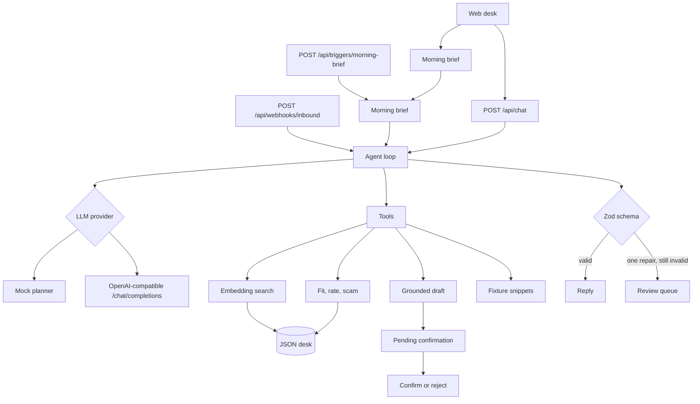
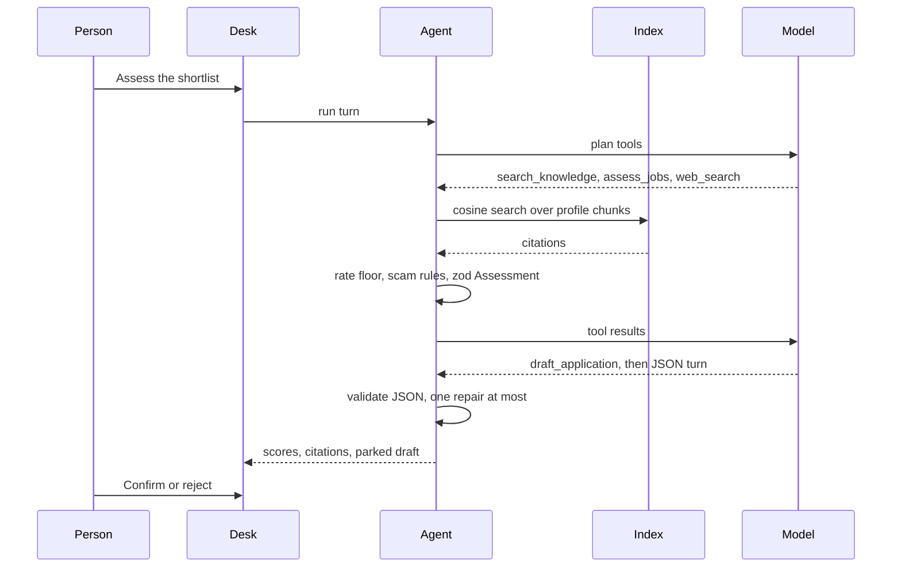

# Agentic Personal Assistant

This is a personal portfolio build by Charlene Cordero. It is based on the public CWB Hackathon problem statement from id8nxt, [Build your agentic personal assistant](https://www.cwbhackathon.com/problem-statements/general-problem-statement-build-your-agentic-personal-assistant). It is not a submission, and it does not claim a prize, a client, or a measured business result.

Agentic Personal Assistant is a local desk for a fictional freelancer. It reads a made-up profile with embeddings, scores synthetic posts for fit, rate, and scam risk, and parks every draft until a person confirms it. Nothing is submitted. The person in the sample data is Mara Ellison. She is invented. The job posts are invented.

## Problem

A freelancer can lose an afternoon to posts that pay under the floor, ask for a deposit, or hide instructions in the brief. The desk keeps the calendar and the task list, retrieves the profile by similarity, and returns a structured assessment with citations. A cover note is drafted only from profile text. Lines that are not in the profile are marked `[VERIFY]`. The note waits under Pending.

## Architecture





## Tools

| Tool | What it does | Leaves the machine? |
| --- | --- | --- |
| `list_events`, `create_event` | Local calendar | No |
| `list_tasks`, `create_task`, `complete_task` | Local tasks | No |
| `search_knowledge`, `search_notes`, `recall_memory` | Cosine search over profile, notes, and memory | No |
| `remember`, `create_note` | Save text and re-embed it | No |
| `assess_jobs` | Fit score, rate floor, scam flags, citations | No |
| `web_search` | Snippets from `fixtures/web` only | No |
| `draft_application`, `draft_outbound` | Park a note for confirmation | No |
| `list_pending` | Show parked notes | No |

There is no send, submit, or login tool.

## Data

One JSON file (`DATA_PATH`, default `data/canopy.json`). It holds the calendar, tasks, notes, memory, embedding chunks, assessments, the review queue, safety findings, and parked drafts. Profile text lives in `lib/profile.ts`. Posts and gold labels live in `lib/jobs.ts`.

This is not Postgres, and there is no row-level security. One local user. Do not put the file on a shared server without adding auth. `DEMO_UI=false` and a real `TRIGGER_TOKEN` are the minimum if the port is reachable.

Rate math, used by the assessor and covered by a test:

`minimum budget = hours × floor ÷ (1 − platform fee)`

The sample floor is 75 USD/hour and the fee is 10 percent, so 20 hours needs 1666.67 USD.

## Run it

Node.js 22+.

```bash
npm install && npm test && npm run dev
```

Open [http://127.0.0.1:3847](http://127.0.0.1:3847).

Copy `.env.example` to `.env` when you change the model or the token. `.env` is gitignored.

In development the trigger token defaults to `dev-trigger-token`. Production leaves it empty until you set `TRIGGER_TOKEN`, and the webhook and cron routes stay closed.

With the server up:

```bash
npm run demo
```

## Demo script

1. The shortlist is on the right: a strong Harbor Ledger post, a cheap sync, and a Bitcoin post.
2. Click **Assess shortlist** (or send `Assess the shortlist and prep the best one.`). The trace shows retrieval, `assess_jobs`, a fixture web snippet, and `draft_application`.
3. Harbor Ledger is the one worth a reply. The cheap post misses the floor. The Bitcoin post is flagged and is not drafted as a real application.
4. The cover note cites profile sentences. Anything else is prefixed `[VERIFY]`. It sits under Pending. **Confirm** records a simulated email. **Reject** drops it.
5. **Morning brief** still reads the calendar and the open tasks.
6. Reset puts the fictional week back.

Inbound webhook, from another terminal:

```bash
curl -s -X POST http://127.0.0.1:3847/api/webhooks/inbound \
  -H 'content-type: application/json' \
  -H 'x-trigger-token: dev-trigger-token' \
  -d '{"source":"board.example","type":"inquiry","from":"maya@example.com","subject":"Webhook router quote","body":"Could you scope a TypeScript webhook router, about twelve hours?"}'
```

Morning brief trigger:

```bash
curl -s -X POST 'http://127.0.0.1:3847/api/triggers/morning-brief?force=1' \
  -H 'x-trigger-token: dev-trigger-token'
```

## Models

`LLM_PROVIDER=mock` uses the deterministic planner. No key.

`LLM_PROVIDER=openai` posts to any OpenAI-compatible `/chat/completions`. That includes OpenAI, Groq, Ollama, and a LiteLLM proxy. Paid models stay off until you set a base URL and a key.

Ollama on the same machine:

```bash
docker run -d --name canopy-ollama -p 11434:11434 ollama/ollama
docker exec canopy-ollama ollama pull qwen2.5:7b-instruct
```

```bash
LLM_PROVIDER=openai
LLM_BASE_URL=http://127.0.0.1:11434/v1
LLM_API_KEY=ollama
LLM_MODEL=qwen2.5:7b-instruct
```

A local host with an empty key is sent `Authorization: Bearer ollama`. This environment did not pull a model. The HTTP path is checked against a local fixture server in `tests/repair.test.ts`: the client posts to `/v1/chat/completions` and parses a tool call for `assess_jobs`.

Embeddings: the running index is `local-hash-v1`, a deterministic feature hash, so mock mode and CI do not call out. `remoteEmbed` in `lib/embeddings.ts` speaks `/embeddings` and is tested with a recorded payload. `EMBEDDING_PROVIDER=openai` is accepted as config. The desk does not mix those vectors into the local index, because the spaces are not the same. Rebuild would be a deliberate change in `reindex`.

## Failure handling

| Failure | What happens |
| --- | --- |
| Model JSON is off schema | One repair prompt. If it fails again, the raw text goes to the review queue with reason `model_output_off_schema: …`. The reply says it was parked. No score is invented. |
| Web fixture misses | The assessment says not web-verified. |
| Outbound webhook errors | The draft stays pending. |
| Scam or injection text | Red flag, fit band poor, draft marked `[VERIFY]`, safety finding stored. |

## Tests

```bash
npm test
```

Covers the Manila clock, the morning-brief rule, the desk tools, semantic rank, all 15 gold labels, rate math, the injection post, grounding, confirm-before-send, schema repair, the review queue, and the OpenAI-compatible fixture. No network.

## Free-tier deploy

The app is a long-running Node process and a JSON file. A small VM or a container with a disk fits. Serverless hosts will not keep the file.

```bash
cp .env.example .env
# set TRIGGER_TOKEN, DEMO_UI=false, DATA_PATH on a persistent disk
npm ci && npm test && npm run build && npm start
```

`next start` listens on port **3847**. A `Dockerfile` is included. Mount a volume at `/data` and set `DATA_PATH=/data/canopy.json`. Free container allowances change. Check the current terms. This repo does not provision an account.

## Status / limitations

In this slice:

- Calendar, tasks, notes, semantic retrieval, structured assessments, grounded drafts, and human confirmation.
- Zod on the assistant turn and on every assessment. One repair, then the review queue.
- Offline web snippets. A recorded OpenAI-compatible chat call.

Out of scope, on purpose:

- LangGraph, LiteLLM as a proxy process, Ollama pulled into this repo, and a second local model as fallback.
- Supabase, pgvector, row-level security, and object storage.
- SearXNG, live page fetches, and a Postgres web cache.
- n8n. The morning brief is an HTTP trigger plus an optional in-process timer. No Telegram or email provider.
- Langfuse, Promptfoo, and a `make eval` number. Do not treat the gold-label test as a model accuracy score.
- A Cloudflare Pages frontend and a Worker in front of the API.
- gitleaks, multi-user auth, and a real mail send.

Safety notes for the checks that do exist are in [docs/SAFETY.md](docs/SAFETY.md).
